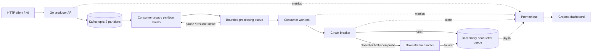
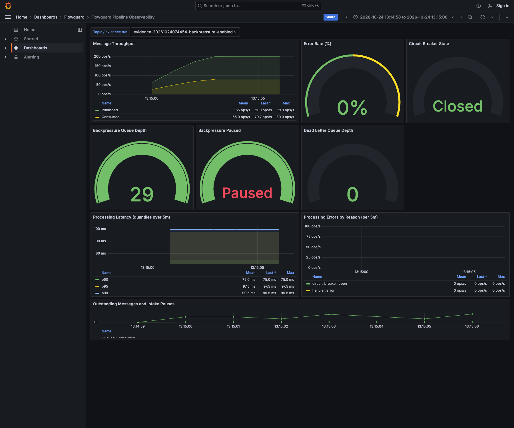
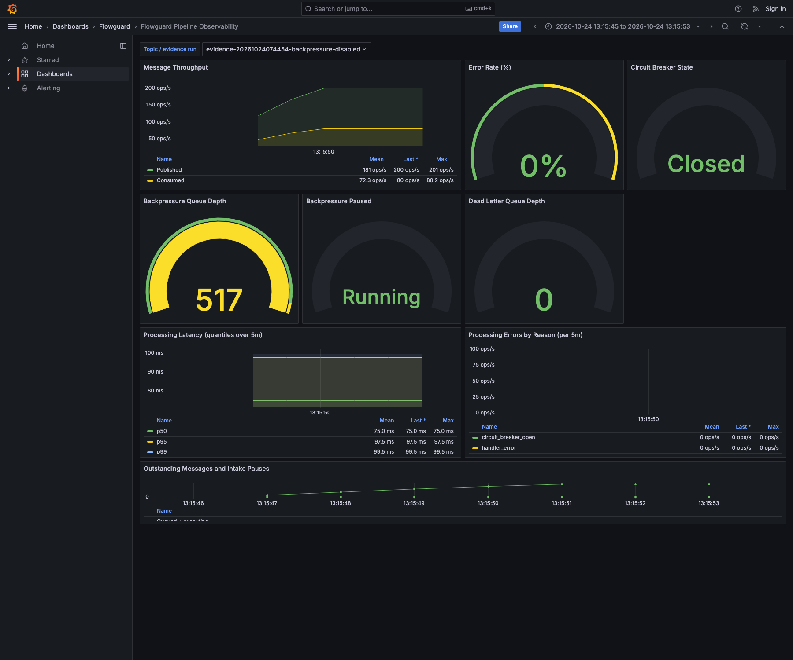
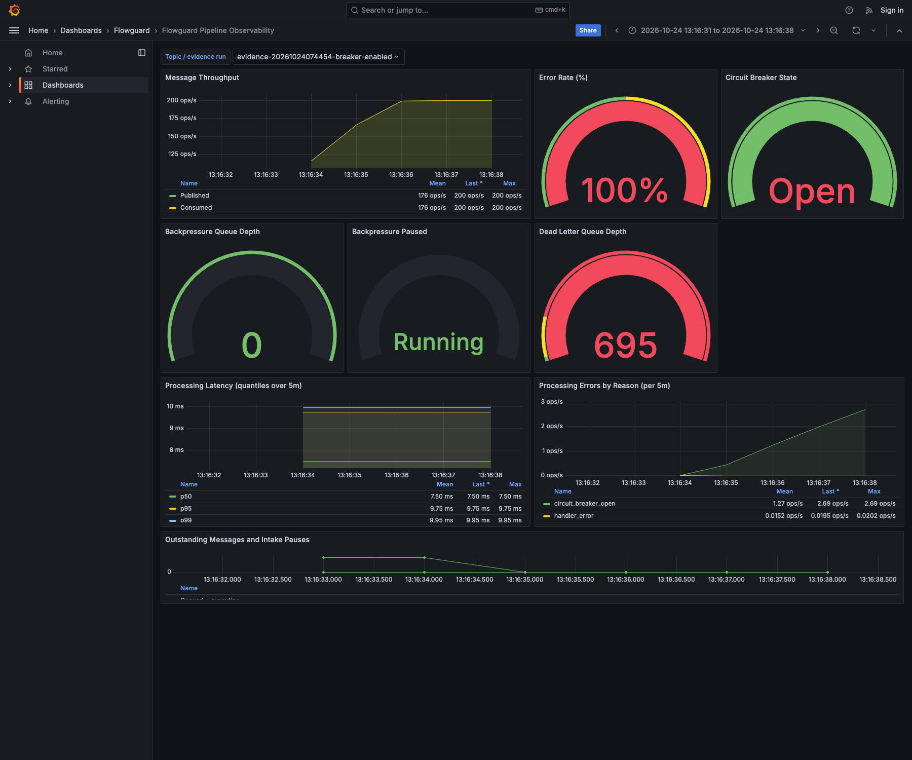

# flowguard

Go/Kafka event pipeline demonstrating backpressure, circuit breaking and observable failure handling.

## Gap checklist — 24 Oct 2026

- [x] 1. Real architecture flow diagram including producer, Kafka, consumers, breaker, DLQ and monitoring.
- [x] 2. Like-for-like enabled and disabled runs with identical settings and fresh topics.
- [x] 3. Failure run opens the breaker, probes half-open and recovers closed; transition log captured.
- [x] 4. Historical count discrepancy explained; new per-run accounting balances exactly.
- [x] 5. Measurable local outstanding-work reduction and failed downstream-call reduction documented.
- [x] 6. Both tracked binaries removed; generated paths ignored, source-build commands and CI artifacts added.
- [x] 7. Repository-local PRD explicitly selects Kafka and supersedes the old RabbitMQ wording.
- [x] 8. Backpressure, breaker and degradation tests pass locally with race detection and recorded coverage.

The checklist is verified by the raw artifacts linked below; it does not claim an upstream Notion edit or a CI run.

## Endpoints

| Method | Path | Description |
|--------|------|-------------|
| `GET`  | `/health` | Liveness probe |
| `GET`  | `/metrics` | Prometheus metrics endpoint |
| `GET`  | `/openapi.json` | OpenAPI 3.1 spec |
| `POST` | `/v1/send-message` | Publish a message to the Kafka `RECONCILIATION` topic |

### Example

```bash
curl -X POST http://localhost:3000/v1/send-message \
  -H "Content-Type: application/json" \
  -d '{"message":"world"}'
```

```json
{
  "data": {
    "echo": "Hello from world",
    "receivedAt": "2026-09-30T18:45:46.663Z"
  },
  "traceId": "2d23ab1b-8de5-4662-b75e-4468fa209dc7",
  "timestamp": "2026-09-30T18:45:46.663Z"
}
```

## Product Requirements Document (PRD)

[Kafka PRD and broker decision](docs/PRD.md)


## Quick Start

```bash
# With Go installed
go run ./cmd/server

# Or via Docker
docker compose up --build

# Access services:
# - API: http://localhost:3000
# - Metrics: http://localhost:3000/metrics
# - Grafana: http://localhost:3002 (admin/admin)
# - Prometheus: http://localhost:9090
```

The server listens on `0.0.0.0:3000` by default (override with `-port` or `PORT` env).

## Configuration

The server reads environment variables; Docker Compose also reads its `.env` interpolation file. `go run` does not load `.env` automatically:

| Variable | Default | Description |
|----------|---------|-------------|
| `ENV` | `development` | `development` \| `staging` \| `production` |
| `HOST` | `0.0.0.0` | Bind address |
| `PORT` | `3000` | Listen port |
| `LOG_LEVEL` | `info` | `trace`\|`debug`\|`info`\|`warn`\|`error`\|`fatal` |
| `RATE_LIMIT_MAX` | `100` | Requests per window per client |
| `RATE_LIMIT_TTL_MS` | `60000` | Rate-limit window (ms) |
| `REDIS_URL` | *(empty)* | When set, enables distributed rate limiting |
| `KAFKA_BROKERS` | *(empty)* | Kafka broker list (comma-separated); empty disables the producer (returns 503) |
| `KAFKA_TOPIC` | `RECONCILIATION` | Topic for `/v1/send-message` publishes |
| `KAFKA_TIMEOUT_MS` | `5000` | Producer broker timeout (synchronous Sarama call) |
| `DISABLE_BACKPRESSURE` | `false` | Bypass pause/resume and local intake gating |
| `DISABLE_CIRCUIT_BREAKER` | `false` | Call the handler directly; retain fallback handling |
| `BACKPRESSURE_MAX_QUEUE_DEPTH` | `1000` | Waiting-job channel capacity |
| `BACKPRESSURE_PAUSE_AFTER_DEPTH` | `800` | Pause at queued + executing depth |
| `BACKPRESSURE_RESUME_AFTER_DEPTH` | `200` | Resume at this depth |
| `CONSUMER_MAX_CONCURRENCY` | `4` | Fixed worker count |
| `HANDLER_PROCESSING_MS` | `5` | Simulated work per message |
| `CIRCUIT_BREAKER_THRESHOLD` | `3` | Consecutive failures before opening |
| `CIRCUIT_BREAKER_COOLDOWN_MS` | `30000` | Delay before a half-open probe |

Copy `.env.example` to `.env` and export values when running Go locally. The main Compose demo uses a 512-job queue, 32/8 thresholds, four workers and 50ms work; the evidence runner records its own fixed settings.

## Production Features

- **Consumer groups** — partition assignment supports multiple members; the demo DLQ remains process-local
- **Structured JSON logging** — ingestible by any log aggregator
- **Request tracing** — `X-Request-Id` header propagated end-to-end
- **Rate limiting** — in-memory (dev) or Redis-backed (prod) per-client
- **Graceful shutdown** — finishes in-flight requests on SIGTERM, flushes Kafka producer
- **Security headers** — CSP, HSTS, X-Frame-Options, etc.
- **OpenAPI spec** — served at `/openapi.json`
- **Health endpoint** — `/health` for k8s liveness probes
- **Kafka integration** — publishes to configurable topic, fail-fast at startup, graceful flush on shutdown
- **Resilience mechanisms** — backpressure, circuit breaker, graceful degradation (dead-letter queue)
- **Observability** — Prometheus metrics endpoint at `/metrics`, Grafana dashboards

## Architecture



The API process owns a Kafka producer and a consumer group member with multiple
partition claims and a fixed worker pool. Kafka distributes partitions between
members if more processes use the same group. Completion callbacks advance only
contiguous completed offsets, preserving unfinished records across a restart.
Delivery is at least once; handlers must tolerate duplicates. The demo DLQ is
**in memory**, so parked records are lost on process exit after acknowledgement;
a durable Kafka DLQ is required before using this degradation path in production.

## Resilience Mechanisms (Phase 2)

The consumer implements three resilience mechanisms to survive real-world failure modes:

### 1. Backpressure
When the consumer's processing queue backs up past a threshold, intake is paused to prevent unbounded memory/queue depth growth. The system slows or pauses intake rather than letting queue depth grow indefinitely.

### 2. Circuit Breaker
When a downstream dependency fails repeatedly, the breaker opens and stops calling it for a cooldown period, instead of retrying into a wall. After the cooldown, it allows a trial call to test if the dependency has recovered.

### 3. Graceful Degradation
When the circuit breaker is open and a message cannot be fully processed, the consumer parks the message in a dead-letter queue instead of crashing or silently dropping it.

Each mechanism is independently triggerable in tests for verification.

## Observability (Phase 3)

The system exports Prometheus metrics for monitoring:

- `flowguard_messages_published_total` - Total messages published to Kafka
- `flowguard_messages_consumed_total` - Total messages consumed from Kafka
- `flowguard_processing_latency_seconds` - Processing latency histogram
- `flowguard_processing_errors_total` - Total processing errors
- `flowguard_circuit_breaker_state` - Current circuit breaker state (0=closed, 1=open, 2=half-open)
- `flowguard_dead_letter_queue_depth` - Current dead-letter queue depth
- `flowguard_backpressure_depth` - Current backpressure queue depth
- `flowguard_backpressure_paused` - Whether intake is currently paused (1=paused, 0=not paused)

These metrics are available at `/metrics` endpoint and can be scraped by Prometheus. A pre-configured Grafana dashboard is included in the docker-compose setup.

### Local Development with Observability

```bash
# Start all services
docker compose up --build

# Wait for services to be ready (~30 seconds)
# Then access:
# - API: http://localhost:3000
# - Metrics: http://localhost:3000/metrics
# - Grafana: http://localhost:3002 (login: admin/admin)
# - Prometheus: http://localhost:9090
```

### Load Testing

The project includes a k6 load test script to validate resilience mechanisms:

```bash
# Install k6 (if not available): https://k6.io/docs/getting-started/installation/

# Run a basic load test
./scripts/load-test.sh

# Customize the test
./scripts/load-test.sh --duration 1m --vus 50 --rate 200

# Test with external Kafka
./scripts/load-test.sh --url http://localhost:3000
```

### Controlled comparison (24 Oct 2026)

Evidence and exact results are generated by `scripts/run-evidence.py` and stored
in [docs/evidence/results.json](docs/evidence/results.json). Each run creates a
fresh three-partition Kafka topic and consumer group, waits for assignment, and
starts at zero. Within each scenario the settings are identical, except for the
two explicit disable switches. The fallback DLQ and hard queue capacity remain
in place in the disabled baseline to bound the experiment.

<!-- evidence-results:start -->
Both modes: **15s**, offered **200 requests/s**, **200 preallocated/max VUs**,
four workers, queue capacity 512, pause/resume 32/8, breaker threshold 3 and
cooldown 2s. There were **zero dropped k6 iterations and zero HTTP errors** in all
four runs. A one-request difference is the arrival scheduler's interval boundary.

| Scenario / mode | HTTP requests = published = consumed | Measured req/s | HTTP p95 ms | Peak queued + executing | Downstream calls | Failed downstream calls | Succeeded | Parked in DLQ |
|---|---:|---:|---:|---:|---:|---:|---:|---:|
| backpressure-enabled | 3,001 | 199.91 | 1.55 | 32 | 3,001 | 0 | 3,001 | 0 |
| backpressure-disabled | 3,000 | 199.91 | 1.95 | 517 | 3,000 | 0 | 3,000 | 0 |
| breaker-enabled | 3,000 | 199.89 | 2.22 | 18 | 1,798 | 6 | 1,792 | 1,208 |
| breaker-disabled | 3,001 | 199.84 | 1.61 | 4 | 3,001 | 1,200 | 1,801 | 1,200 |

Backpressure reduced peak local outstanding work from **517 to 32**
(**93.8% lower**). All overload messages eventually succeeded. It does not
increase handler capacity: Kafka retains the remaining backlog while local
intake is paused. The disabled mode still has a hard queue cap, so this is a
comparison of early intake control and local outstanding count, not a claim of
unbounded memory or higher throughput. Both runs end at depth 0 and paused=false.

During the identical six-second dependency outage, the breaker reduced failed
downstream calls from **1,200 to 6**
(**99.5% fewer**). Open-circuit messages are parked immediately; successful
processing is slightly lower because probes intentionally wait for cooldown.
The benefit is reduced pressure on the failing dependency, not a guaranteed
improvement in HTTP latency or success rate. DLQ storage is not durable.

Every run starts at 0 and drains to the published count shown above. For example,
`3,000 = 1,792 succeeded + 1,208 parked` in the breaker-enabled run.
The raw snapshots also record the unique topic/group names and UTC timestamps.

Backpressure enabled (paused intake visible) and disabled, at times within their
respective runs; the topic selector prevents earlier runs contaminating charts:




Breaker open during the outage:



[Full transition log, including half-open and recovery](docs/evidence/breaker-enabled.log):

```text
2026/10/24 13:16:33 circuit_breaker from=closed to=open
2026/10/24 13:16:35 circuit_breaker from=open to=half-open
2026/10/24 13:16:35 circuit_breaker from=half-open to=open
2026/10/24 13:16:37 circuit_breaker from=open to=half-open
2026/10/24 13:16:37 circuit_breaker from=half-open to=open
2026/10/24 13:16:39 circuit_breaker from=open to=half-open
2026/10/24 13:16:39 circuit_breaker from=half-open to=closed
```

<!-- evidence-results:end -->

Reproduce against a separate local stack (ports 39092, 3330, 9095, 3005):

```bash
docker compose -p flowthrough-evidence -f deploy/evidence/compose.yml up -d --wait
go build -o bin/evidence ./cmd/evidence
# Install k6 locally; screenshots also require Python playwright and Chromium:
python3 -m pip install playwright
python3 -m playwright install chromium
python3 scripts/run-evidence.py
# This also validates accounting and refreshes README tables.
```

The harness uses the real HTTP handler, acknowledged Kafka producer, consumer
group, worker queue, breaker and DLQ. The downstream dependency is simulated:
50ms work in the overload scenario, 5ms work with an outage during seconds 2–8
in the breaker scenario. The peak-depth sampling interval is 5ms and snapshots are collected every 100ms; raw before/after snapshots,
samples, k6 JSON summaries and transition logs are retained beside the screenshots. Grafana captures use explicit historical timestamps within each load run, taken after load generation to avoid browser CPU interference.
HTTP acknowledgement measures enqueue latency, not end-to-end processing latency.

### Why the old numbers did not add up

The old +22,295 consumed versus 2,985 sent compared cumulative consumption of
historical Kafka records with one HTTP run. The old consumer always opened
partition 0 at `OffsetOldest`, ignored the supplied group ID and did not persist
completion offsets, so restarting replayed earlier runs. That delta cannot be
attributed to retries or to those 2,985 requests, and the old comparison is
withdrawn. It also ignored the other partitions. The replacement consumer uses
all assigned partitions and group offsets. New experiments isolate topics and
require `published = consumed = succeeded + dead_lettered` after draining.

The old load script also failed to pass its CLI settings to k6. Requests were
actually generated at its defaults of 100/s for 30s, regardless of the requested
flags; the old 50/s and 150/s claims were incorrect. Throughput in the tables above is read from
k6's measured request rate, with dropped iterations reported separately.

### Design Rationale

The flowguard pipeline implements resilience through three complementary mechanisms: backpressure prevents system overload by pausing intake when queue depth exceeds thresholds, circuit breaker stops repeated calls to failing dependencies to allow recovery, and dead-letter queue provides graceful degradation by preserving messages that cannot be processed. These mechanisms work together to ensure the system remains operational under varying load conditions and failure scenarios. The backpressure configuration uses hysteresis (different pause/resume thresholds) to prevent oscillation near the threshold boundary. Circuit breaker follows the standard closed/open/half-open states with configurable failure threshold and cooldown period. The in-memory dead-letter queue stores failure reasons for inspection during the process lifetime; replay tooling and durable storage are not implemented. All mechanisms are independently observable through Prometheus metrics, enabling operators to tune parameters based on observed behavior in production.

### Portfolio Write-up

**Problem:** Building a reliable message pipeline that can ingest HTTP requests, buffer them via Kafka, and process them resiliently despite real-world failures like traffic spikes, downstream outages, or processing bugs—with explicit failure accounting and observable intake control.

**Three Hardest Design Decisions:**
1. **Choosing hysteresis-based backpressure thresholds** (the controlled run pauses at 32 and resumes at 8) to avoid oscillation near the boundary while still protecting against unbounded queue growth.
2. **Implementing the circuit breaker with a half-open state** to safely test dependency recovery without overwhelming a healing service.
3. **Decoupling the dead-letter queue from Kafka** (in-memory fallback) so graceful degradation works even when Kafka itself is unavailable, trading durability for availability during total outages.

**What I’d Improve with More Time:**
- Add persistent dead-letter queue (e.g., to a separate Kafka topic or disk) for replay after recovery.
- Introduce adaptive backpressure that tunes pause/resume thresholds based on observed latency and error rates.
- Expand observability with end-to-end latency tracing (e.g., OpenTelemetry) to pinpoint bottlenecks across HTTP→Kafka→consumer→handler.

## Testing

Local race-enabled tests passed on 24 Oct 2026. Statement coverage:
**resilience 89.7%**, **consumer 66.9%**, **Kafka adapter 36.6%**,
**observability 56.5%** (whole project 32.9%; CLI/HTTP scaffolding is not covered).
[Full result](docs/evidence/tests.txt) · [Function coverage](docs/evidence/coverage.txt).
Regression tests verify queued-work depth, pause/resume and bypass behavior,
contiguous completion offsets, stale-session acknowledgements, concurrent breaker
probes, graceful degradation, and metrics registry isolation. CI runs the same
race-enabled command and uploads coverage and built binaries as artifacts.


```bash
go test ./... -race -count=1 -coverprofile=coverage.out -covermode=atomic
go tool cover -func=coverage.out
go vet ./...
```

## Build

Generated executables live in ignored `bin/`. CI builds CLI artifacts and uploads
them with coverage; no binaries belong in source control. The two previously
tracked executables are removed from the working tree; Git history is unchanged.


```bash
# Local binary
go build -trimpath -o bin/flowguard ./cmd/server

# Optional file-publishing utility (unrelated to choosing Kafka for the PRD)
go build -o bin/publish-prd ./cmd/publish-prd

# With version metadata
go build -ldflags="-X main.version=1.2.3" -o bin/flowguard ./cmd/server
```

## Docker Compose

The provided docker-compose.yml includes:
- flowguard API (with Kafka connectivity)
- Kafka broker (confluentinc/cp-kafka)
- Prometheus (for metrics collection)
- Grafana (for visualization with pre-built dashboard)

All services are configured to work together out-of-the-box.

## License

MIT